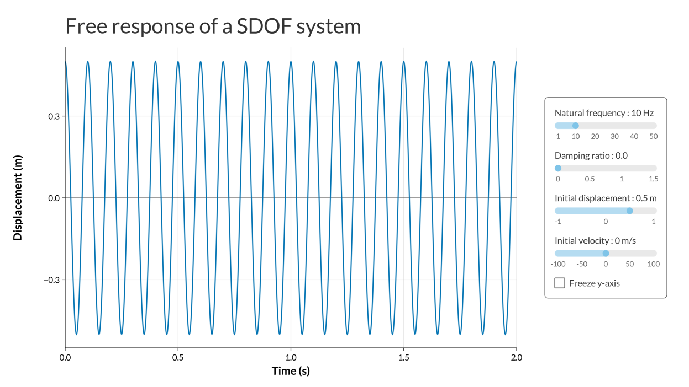
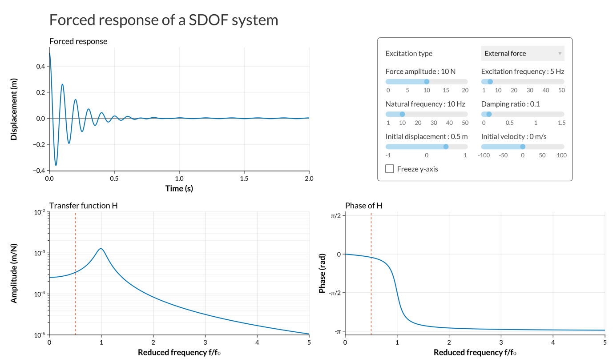
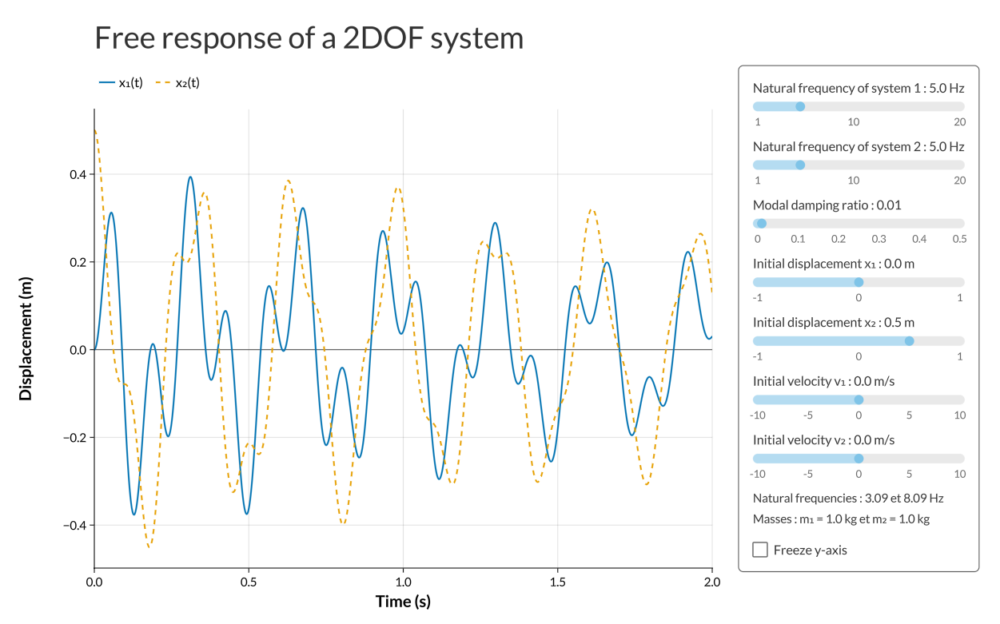
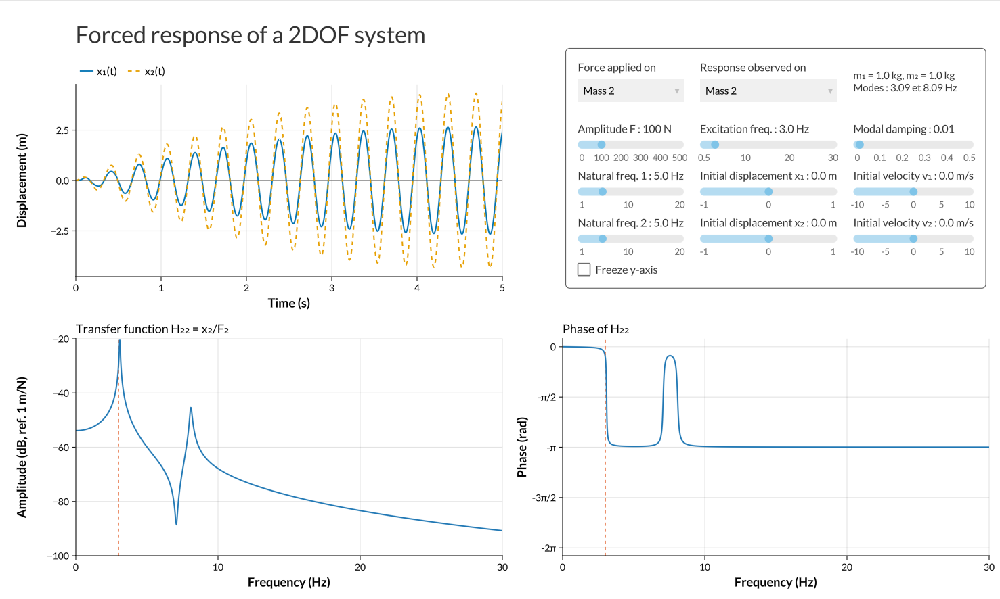
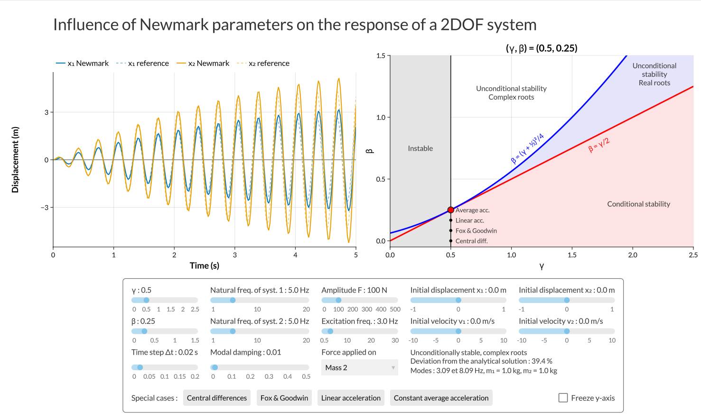

```{julia}
#| echo: false
#| output: false
using StructuralVibration, ShareAdd
@usingany GLMakie
```

`StructuralVibration.jl` provides a set of applications for simulating the dynamic response of 1-DOF and 2-DOF systems. These applications are designed to help users understand the behavior of these systems under various conditions.

These applications are intended to be used as educational tools, allowing users to explore the effects of different parameters on the system's response. The applications are defined as an extension `SVAppsExt.jl`.

Five applications are provided:
- **Free Response of a 1-DOF System**: This application simulates the free response of a single degree of freedom system, allowing users to observe how the system behaves when it is displaced from its equilibrium position and then released.

- **Forced Response of a 1-DOF System**: This application simulates the forced response of a single degree of freedom system, allowing users to observe how the system responds to an external force applied to it.

- **Free Response of a 2-DOF System**: This application simulates the free response of a two degree of freedom system, allowing users to observe how the system behaves when it is displaced from its equilibrium position and then released.

- **Forced Response of a 2-DOF System**: This application simulates the forced response of a two degree of freedom system, allowing users to observe how the system responds to an external force applied to it.

- **Newmark Method for a 2-DOF System**: This application implements the Newmark method for simulating the response of a two degree of freedom system, allowing users to observe how the system responds to various parameters.

## Free Response of a 1-DOF System



```julia
free_response_1dof()
```

::: {.api}
**free_response_1dof**

---

```{julia}
#| echo: false
@doc free_response_1dof
```
:::

## Forced Response of a 1-DOF System



```julia
forced_response_1dof()
```

::: {.api}
**forced_response_1dof**

---

```{julia}
#| echo: false
@doc forced_response_1dof
```
:::

## Free Response of a 2-DOF System



```julia
free_response_2dof()
```

::: {.api}
**free_response_2dof**

---

```{julia}
#| echo: false
@doc free_response_2dof
```
:::

## Forced Response of a 2-DOF System



```julia
forced_response_2dof()
```

::: {.api}
**forced_response_2dof**

---

```{julia}
#| echo: false
@doc forced_response_2dof
```
:::

## Newmark Method for a 2-DOF System



```julia
newmark_2dof()
```

::: {.api}
**newmark_2dof**

---

```{julia}
#| echo: false
@doc newmark_2dof
```
:::